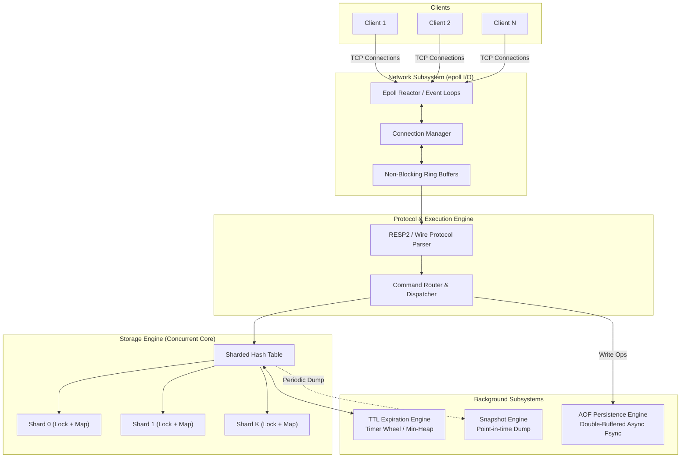

# Aegis: Architecture & Implementation Roadmap

> **High-Level Blueprint for Building a High-Performance, Concurrent, In-Memory Key-Value Store**  
> **Tech Stack**: C++20 | Linux | POSIX Sockets | `epoll` | Multithreading | CMake | GoogleTest | Google Benchmark

---

## 1. Architectural Blueprint

Aegis is architected into clean, decoupled layers separating network I/O, protocol parsing, concurrency dispatch, in-memory storage, and background persistence subsystems.



---

## 2. Core Subsystems Overview

### A. Network Engine (`src/net/`)
- **Responsibility**: Manages socket life cycles, event loops via Linux `epoll`, and non-blocking streaming I/O.
- **Key Components**:
  - `Socket`: RAII wrapper around Linux file descriptors (`socket`, `bind`, `listen`, `accept4`).
  - `EpollReactor`: Manages `epoll_create1`, `epoll_ctl`, and `epoll_wait` loop.
  - `Connection`: Tracks per-client state, read/write non-blocking byte buffers, and connection keep-alive.
  - **I/O Model**: Master-Acceptor with worker thread pools OR Multi-Reactor using `SO_REUSEPORT` for kernel-level connection balancing.

### B. Protocol Parser (`src/protocol/`)
- **Responsibility**: Zero-copy decoding of client byte streams into executable commands and encoding server responses.
- **Supported Format**: **RESP2 (Redis Serialization Protocol)** to enable plug-and-play compatibility with `redis-cli`, Python `redis-py`, and `memtier_benchmark`.
- **Key Components**:
  - `ProtocolParser`: Incremental, stateful parser working over `std::string_view` without allocating memory for intermediate tokens.
  - `Command`: Encapsulates command types (`GET`, `SET`, `DEL`, `EXPIRE`, `PING`, etc.) and argument spans.

### C. In-Memory Storage Engine (`src/storage/`)
- **Responsibility**: High-concurrency, low-latency key-value operations with predictable cache behavior.
- **Architecture**: **Lock-Striped Sharded Hash Table**.
  - Hash space partitioned across $2^N$ shards (e.g., 64 or 256 shards).
  - Shard lookup: `shard_index = MurmurHash3(key) & (NUM_SHARDS - 1)`.
  - Each shard is protected by an independent `std::shared_mutex` (or reader-writer spinlock), allowing thousands of concurrent reads and isolated writes without global lock contention.
  - Cache-line padded: `alignas(64)` on each shard to eliminate false sharing.

### D. TTL & Eviction Engine (`src/ttl/`)
- **Responsibility**: Automatically expire keys according to specified time-to-live timestamps.
- **Two-Tier Expiration Strategy**:
  1. **Lazy (Passive)**: Checked upon each `GET`/`SET` query. If `now() >= expiry`, evict key immediately and return `nil`.
  2. **Active (Background)**: A dedicated `std::jthread` sleeps and periodically samples a Min-Heap / Hierarchical Timer Wheel to purge expired keys before memory bloat occurs.

### E. Persistence Engine (`src/persistence/`)
- **Responsibility**: Durability guarantees across server restarts.
- **Pluggable Subsystems**:
  1. **AOF (Append-Only File)**: Command stream logging with a double-buffering queue. Worker thread performs `fdatasync()` according to configured policy (`always`, `everysec`, `no`).
  2. **Snapshotting**: Compact serialization of all active key-value pairs to disk with point-in-time recovery.

### F. Benchmarking & Quality Assurance (`tests/` & `benchmarks/`)
- **GoogleTest (`gtest`)**: Unit tests for protocol parsing, edge-case framing, TTL accuracy, and concurrent race-condition stress tests.
- **Google Benchmark (`benchmark`)**: Microbenchmarks measuring lock contention across thread counts (1, 2, 4, 8, 16, 32 threads) and operations/sec for single-key vs. striped-shard lookups.
- **Tooling Integrations**: AddressSanitizer (`ASan`), ThreadSanitizer (`TSan`), Valgrind, and `perf` profiling.

---

## 3. Implementation Roadmap (Phases)

```mermaid
gantt
    title Aegis Implementation Phases
    dateFormat  X
    axisFormat Phase %X
    section Scaffolding & Core
    Phase 0: Toolchain & Build Setup       :0, 1
    Phase 1: Concurrent Storage Engine     :1, 2
    Phase 2: Protocol Parser (RESP2)       :2, 3
    section Networking & Concurrency
    Phase 3: epoll Network Engine          :3, 4
    Phase 4: Multi-Threaded Dispatch       :4, 5
    section Subsystems & Tuning
    Phase 5: TTL & Expiration Subsystem    :5, 6
    Phase 6: Persistence (AOF & Snapshot)  :6, 7
    Phase 7: Benchmarks & Profiling        :7, 8
```



---

### Phase 0: Project Scaffolding & Toolchain Setup
- **Goal**: Establish a modern C++20 CMake project with build sanitizers and dependencies.
- **Tasks**:
  - Configure `CMakeLists.txt` with C++20 standard, strict compiler warnings (`-Wall -Wextra -Wpedantic -Werror`), and CMake presets (`Debug`, `Release`, `Sanitizers`).
  - Integrate `GoogleTest` and `Google Benchmark` via `FetchContent`.
  - Set up code formatting (`.clang-format`) and static analysis (`.clang-tidy`).
- **Deliverables**: Compiling empty project with working tests running on CI/local Linux.

---

### Phase 1: In-Memory Concurrent Storage Engine
- **Goal**: Implement thread-safe, high-speed storage without any network dependencies.
- **Tasks**:
  - Design value representation (`Value` with support for strings, raw bytes, and expiry timestamp).
  - Implement `ShardedHashMap` with configurable shard counts and fast hashing (e.g., MurmurHash3 or xxHash).
  - Add reader-writer lock striping (`std::shared_mutex` per shard).
  - Implement core operations: `get()`, `set()`, `del()`, `exists()`, `expire()`.
- **Deliverables**: GoogleTest suite verifying correctness, read-write consistency, and multithreaded stress testing with ThreadSanitizer (`TSan`).

---

### Phase 2: Protocol Parser (RESP2)
- **Goal**: Build a zero-copy, incremental parser for Redis Serialization Protocol (RESP2).
- **Tasks**:
  - Implement parser state machine handling Simple Strings (`+`), Errors (`-`), Integers (`:`), Bulk Strings (`$`), and Arrays (`*`).
  - Support fragmented network packets (partial reads buffer state until full frame is available).
  - Implement zero-copy response serializer.
- **Deliverables**: Unit tests covering well-formed commands, split packets, pipelined requests, and malformed inputs.

---

### Phase 3: Single-Threaded epoll Network Engine
- **Goal**: Implement non-blocking event-driven I/O loop.
- **Tasks**:
  - Create `Socket` abstraction (non-blocking flags, `SO_REUSEADDR`, `TCP_NODELAY`).
  - Create `EpollReactor` handling `EPOLLIN`, `EPOLLOUT`, `EPOLLHUP`, `EPOLLERR`.
  - Connect parser and storage engine to serve real `redis-cli` clients over loopback TCP.
- **Deliverables**: Runnable server executable capable of responding to `redis-cli ping`, `redis-cli set key val`, and `redis-cli get key`.

---

### Phase 4: Multithreading & Event Dispatch Architecture
- **Goal**: Scale network processing across multiple CPU cores.
- **Tasks**:
  - Evaluate and implement concurrency model:
    - **Model 1**: Multi-Reactor with `SO_REUSEPORT` (kernel distributes incoming connections across dedicated epoll loops).
    - **Model 2**: Acceptor thread + Worker Thread Pool with lock-free work queues.
  - Wire multithreaded network workers to the sharded storage engine.
  - Benchmark performance gains moving from 1 core to 4+ cores.
- **Deliverables**: Server scaling throughput linearly with CPU cores under concurrent client load.

---

### Phase 5: TTL & Eviction Engine
- **Goal**: Implement automatic key expiration and memory bounds.
- **Tasks**:
  - Implement lazy expiration check inside `get()` / `exists()`.
  - Implement background active expiration worker using a Min-Heap (`std::priority_queue`) or Timer Wheel.
  - Add eviction policies (e.g., Volatile-LRU or No-Eviction when maximum memory limit is reached).
- **Deliverables**: Tests verifying expired keys return `nil` immediately upon passive access and background thread frees expired memory over time.

---

### Phase 6: Persistence Subsystem (AOF & Snapshot)
- **Goal**: Implement durable write-ahead logging and point-in-time snapshots.
- **Tasks**:
  - Design `AOFWriter` utilizing a ring buffer and asynchronous flush thread.
  - Implement configurable fsync policies (`always`, `everysec`, `no`).
  - Implement AOF replay logic during server startup.
  - (Optional / Stretch) Snapshotting engine using `fork()` copy-on-write or partition serialization.
- **Deliverables**: Crash-recovery test: write data, kill process, restart, verify all key-value state is fully recovered from AOF.

---

### Phase 7: Benchmarks, Profiling & Hardening
- **Goal**: Prove performance, identify bottlenecks, and validate thread safety.
- **Tasks**:
  - Create comprehensive Google Benchmark suites measuring shard contention under variable reader/writer ratios.
  - Run external load testing using `memtier_benchmark` or `redis-benchmark`:
    - Target: High throughput (e.g., 100k+ ops/sec) with sub-millisecond p99 latency.
  - Profile using Linux `perf record` & generate FlameGraphs to optimize hot paths.
  - Run final validation with ThreadSanitizer and AddressSanitizer.
- **Deliverables**: Final benchmarking report with charts and performance analysis.

---

## 4. Proposed Source Code Directory Layout

```
Aegis/
├── CMakeLists.txt              # Root build configuration
├── cmake/                      # External dependencies (GTest, GBenchmark)
├── include/
│   └── aegis/
│       ├── common/             # Types, Result, RingBuffer, TimeUtils
│       ├── net/                # Socket, EpollReactor, Connection, EventLoop
│       ├── protocol/           # RESP2 Parser, Command, Serializer
│       ├── storage/            # ShardedHashMap, Shard, Value
│       ├── ttl/                # TtlManager, TimerWheel
│       └── persistence/        # AofLogger, SnapshotManager
├── src/
│   ├── main.cpp                # Server entry point
│   ├── net/
│   ├── protocol/
│   ├── storage/
│   ├── ttl/
│   └── persistence/
├── tests/                      # GoogleTest unit & integration tests
│   ├── unit/
│   └── integration/
├── benchmarks/                 # Google Benchmark suites & latency benchmarks
│   ├── storage_benchmark.cpp
│   └── protocol_benchmark.cpp
├── user.md                     # Prerequisites & concepts guide
└── roadmap.md                  # This document
```

---

*Refer to [`user.md`](user.md) for deep-dive reading materials and technical concepts before beginning Phase 0.*
